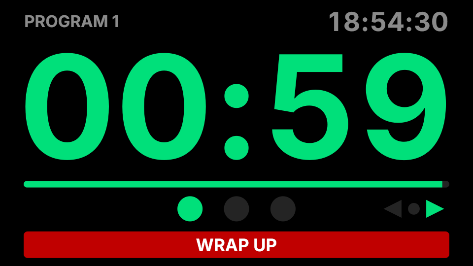

# dsan

Read **DSAN Limitimer** stage timers and drive **DSAN Perfect Cue** presentation remotes from Python, over HTTP/WebSocket, or as OSC.

```
pip install dsan                # library + `dsan` command
pip install 'dsan[server]'      # + HTTP/WebSocket API
pip install 'dsan[osc]'         # + OSC output
pip install 'dsan[viewer]'      # + the desktop viewer app (`dsan-viewer`)
pip install 'dsan[all]'
```

No hardware? Every entry point accepts `sim` as a port, which runs a built-in show simulator through the real decoder.

```
dsan serve --limitimer sim --perfectcue sim      # then open http://localhost:8765/
```

---

## Python library

```python
from dsan import Limitimer, PerfectCue

lt = Limitimer("/dev/tty.usbserial-A1")       # or "COM3", or "socket://10.0.0.50:4001"

@lt.on_change
def changed(state, previous):
    p1 = state.program(1)
    print(state.display(1), "running" if p1.running else "stopped",
          "WARN" if p1.warning else "", "OVER" if p1.overtime else "")

@lt.on_link
def link(status):
    print("link:", status.value)                # opening / waiting / live / stale / reconnecting / closed

lt.start()
```

```python
cue = PerfectCue("/dev/tty.usbserial-B2")      # 19200 baud by default
cue.on_button(lambda button: print("pressed", button.name))   # NEXT / PREV / BLANK_ON / BLANK_OFF
cue.start()

cue.forward()          # >FORWARD 35\r
cue.reverse()
cue.blank(on=True)
cue.send("blank_off")  # names, Command members, or raw bytes
```

Blocking style also works:

```python
with Limitimer("/dev/ttyUSB0") as lt:
    state = lt.wait_for_state(timeout=5)
    print(state.to_dict())
```

### Things worth knowing

- **Callbacks run on the device's reader thread.** Hand work off to your GUI or event loop. `dsan.viewer` (Qt signals) and `dsan.server` (`call_soon_threadsafe`) show both patterns. An exception in your callback is logged and never stops the reader.
- **Ports reconnect automatically.** If a USB adapter re-enumerates, the client retries every second (`reconnect_interval`). Pass `reconnect=False` to disable.
- **Stale detection.** Any valid packet, including the Limitimer's ping, keeps the link `LIVE`. After `stale_after` seconds of silence (default 2) it goes `STALE`. A frozen display is the dangerous failure on a show, so watch `on_link`.
- **`on_change` vs `on_state`.** `on_state` fires on every status packet, several per second. `on_change` fires only when something other than the rolling sequence counter changed.
- **Ports** can be anything pyserial's `serial_for_url` accepts, so RS-485-to-Ethernet converters work with `socket://host:port`.

### The state model

`LimitimerState` is an immutable snapshot; compare with `==`.

| | |
|---|---|
| `state.programs` | four `Program`s (`state.program(n)` for 1-based lookup) |
| `state.selected_index` / `state.selected` | selected program (0-based index / the `Program`) |
| `state.count_down` | DIP 4: countdown (True) or count-up |
| `state.continue_after_zero`, `beep_loud`, `beep_type`, `permit_changes` | DIP 5, 6, 7+8, 9 |
| `state.program_minutes`, `session_minutes` | DIP 3 (P1-3) and DIP 2 (P4): MM:SS instead of HH:MM |
| `state.display(n, overtime=True, follow_device_format=False)` | what a display shows, e.g. `"04:59"`, `"+00:20"` |
| `state.to_dict()` | JSON-ready dict (what the HTTP API returns) |

`Program` (times in seconds): `total`, `sumup`, `elapsed`, `remaining` (signed), `running`, `blink`, `beep`, `warning` (inside sum-up), `expired` (reached zero), `overtime` (past zero), `color` (0 normal / 1 warning / 2 expired).

### Pure protocol, no I/O

```python
from dsan.limitimer import Decoder, parse_status, encode_status
from dsan.perfectcue import command, decode_buttons

for event in Decoder().feed(chunk):          # any chunk size
    if event.ok and (state := parse_status(event.payload)):
        ...
command("FORWARD")                           # b'>FORWARD 35\r'
```

---

## Command line

```
dsan ports                                         # list serial ports
dsan monitor -l /dev/ttyUSB0 -p /dev/ttyUSB1       # live text view (--json for one object per line)
dsan serve   -l /dev/ttyUSB0 -p /dev/ttyUSB1       # HTTP/WebSocket API on 127.0.0.1:8765
dsan serve   -l sim --osc 127.0.0.1:5000           # + OSC output
dsan send    /dev/ttyUSB1 forward                  # one-shot Perfect Cue command
```

`serve` options: `--host 0.0.0.0` (listen on the network), `--port`, `--token SECRET` (require a bearer token), `--osc HOST:PORT`, `--osc-prefix`, `--no-bundle`, `--no-overtime`, `--follow-format`, `--stale-after`, `--reject-zero-crc`, `--pc-baud`.

> If you listen on the network, set `--token`. Without it, anyone on the LAN can advance slides.

---

## HTTP / WebSocket API

Base URL `http://HOST:8765/api/v1`. All responses are JSON and CORS is open. With `--token`, send `Authorization: Bearer SECRET` or `?token=SECRET`. `GET /` serves a small live web page that uses the WebSocket.

| Method | Path | |
|---|---|---|
| GET | `/status` | version, link state, port, packet stats for each device |
| GET | `/limitimer` | `{"link": "live", "state": {…}}` — `state` is `null` until the first packet |
| GET | `/limitimer/programs/{1-4}` | one program |
| GET | `/perfectcue` | link state and last button |
| POST | `/perfectcue/{forward\|reverse\|blank_on\|blank_off}` | send a command (aliases: `next`, `prev`) |
| POST | `/perfectcue/command` | same, with body `{"command": "forward"}` |

Display options as query parameters on the state endpoints and the WebSocket URL: `overtime=false` (hold at 00:00 / total) and `format=device` (follow DIP 2/3).

Command errors: `400` unknown command, `404` device not configured, `503` port not open right now.

### WebSocket `/api/v1/ws`

On connect the server sends a `hello` containing the full snapshot. After that it pushes:

```json
{"type": "limitimer.state", "state": { ... same shape as GET /limitimer ... }}
{"type": "limitimer.link", "link": "stale"}
{"type": "perfectcue.button", "button": "NEXT", "value": 15, "time": 1792240000.12}
{"type": "perfectcue.link", "link": "open"}
```

Clients may send:

```json
{"type": "perfectcue.command", "command": "forward", "id": 1}   → {"type": "result", "id": 1, "ok": true, ...}
{"type": "snapshot"}                                            → a fresh hello
{"type": "ping", "id": 2}                                       → {"type": "pong", "id": 2, ...}
```

`limitimer.state` is sent only on change, roughly once a second while a timer runs.

### Example: Bitfocus Companion

Use the *Generic HTTP* module with a POST to `http://HOST:8765/api/v1/perfectcue/next` to advance slides from a Stream Deck.

---

## OSC

`dsan serve --osc HOST:PORT` (or `dsan.osc.OscBridge`) sends, with prefix `/dsan` and N = 1-4:

| Address | Type | |
|---|---|---|
| `/link` | bool | Limitimer data is live |
| `/countdown` | bool | countdown vs count-up |
| `/selected` | int | selected program 1-4 |
| `/timer/N/time` | string | display string, `+` prefix when over |
| `/timer/N/seconds` | int | display seconds (unsigned) |
| `/timer/N/remaining` | int | signed seconds left |
| `/timer/N/overtime` | bool | past zero |
| `/timer/N/total`, `/sumup`, `/elapsed` | int | seconds |
| `/timer/N/running`, `/warning`, `/expired`, `/blink` | bool | |
| `/timer/N/color` | int | 0 normal · 1 warning · 2 expired |
| `/perfectcue/button` | string | `NEXT` · `PREV` · `BLANK_ON` · `BLANK_OFF` |
| `/perfectcue/value` | int | raw byte `0x0F` · `0x1F` · `0x3F` · `0x2F` |

State updates go out as one OSC bundle per change, so receivers never see half an update. Use `--no-bundle` for receivers that can't handle bundles.

### OSC in — Perfect Cue control

`dsan serve --perfectcue PORT --osc-in 9000` (or `dsan.osc.OscListener`, or **Receive OSC** in Confidence) listens on UDP for, with the same prefix:

| Address | Argument | Does |
|---|---|---|
| `/perfectcue/next`, `/prev` | — | act as if the button was pressed: the screen shows the cue, OSC out sends it on |
| `/perfectcue/blank` | `1` / `0` (none = 1) | blank on / off |
| `/perfectcue/blank_on`, `/blank_off` | — | same, as separate triggers |
| `/perfectcue/press` | `next` · `prev` · `blank_on` · `blank_off` | any press by name |
| `/perfectcue/led` (or `/led/NAME`) | `next` · `prev` · `blank_on` · `blank_off` · `error` | light the Perfect Cue's LEDs (master mode) |
| `/perfectcue/command` (or `/command/NAME`) | `forward` · `reverse` · `blank_on` · `blank_off` | send a receiver command |

Names aren't case-sensitive. A single `0` argument on a trigger address is ignored, so a controller button that sends 1 on press and 0 on release fires once. In Bitfocus Companion, use the *Generic OSC* module and send e.g. `/dsan/perfectcue/next` to Confidence's listen port.

---

### Millumin feedback

Confidence can show what [Millumin](https://www.millumin.com) is playing. Tick **Receive Millumin feedback** in the MILLUMIN box (default port 5001), then in Millumin open the Device Manager (⌘K) → OSC, turn on **API feedback** and send it to the Confidence computer's IP address and that port.

- **Layer:** follow Millumin's selected layer, or pick or type a layer name.
- **Timers, progress bars and phase lights** get a *Millumin* source. A Millumin timer shows the time remaining (counting down), the elapsed time or the duration (TRT). Colours follow Millumin's own time script: green while playing, yellow in the last 30 s, red in the last 10 s and when frozen on the last frame. Both thresholds are set in the MILLUMIN box.
- **Label tokens:** `{clip}` `{layer}` `{column}` `{trt}` `{remaining}` `{elapsed}` `{state}` (PLAYING · PAUSED · STOPPED · FREEZE) `{playmode}` (LOOP · FREEZE · empty).
- **Columns decide what's shown.** While a column is current, its clip stays up even after the media stops, frozen where it stopped (a clip that plays out holds at 0:00). Launching the next column switches to what starts there; if that column has nothing on your layer, Millumin elements go blank. Stopping the column blanks them too.
- **Loop and freeze** aren't in Millumin's OSC feedback, so they're worked out from the time: a jump from the end back to the start is a loop; sitting on the end without a *mediaStopped* is a freeze.
- Millumin sends the running time only for the **selected** layer. For other layers the time runs on from *mediaStarted*.
- The debug console (⌘D) logs every Millumin message, flagging any that aren't used; the many-per-second time updates show only with *Raw bytes* on.

In Python: `dsan.millumin.MilluminReceiver(5001).tracker.view()` gives clip, duration, elapsed, remaining, state and loop/freeze for the selected layer, or pass a layer name to `view()`.

### TruCue feedback

Confidence can show what [TRUCUE](https://trucue.io) is playing. Tick **Receive TruCue feedback** in the TRUCUE box (default port 9017), then in TruCue go to **Settings → OSC**, turn on **Companion feedback** and set its host to the Confidence computer (127.0.0.1 if both run on the same Mac) and the same port.

- **Timers, progress bars and phase lights** get a *TruCue* source. A TruCue timer shows the countdown to OUT, the elapsed time, the duration or the **countdown to the next bookmark**. Colours: green while playing, yellow and red in the last seconds (set in the TRUCUE box), and a looping clip stays green.
- **Label tokens:** `{tc_clip}` `{tc_index}` `{tc_next}` `{tc_prev}` `{tc_remaining}` `{tc_elapsed}` `{tc_trt}` `{tc_state}` (PLAYING · PAUSED) `{tc_playmode}` (LOOP · AUTO NEXT · AUTO FIRST) `{tc_bookmark}` `{tc_bookmark_remaining}` `{tc_volume}`. TruCue's mode marks (🔁 → ↺ B) are taken off clip names. Everything is empty when no clip is loaded.
- **Preset:** *TruCue countdown* — clip, mode, big countdown, progress, next bookmark and its countdown, next clip.
- **Using Companion too:** TruCue sends its feedback to one place. Point TruCue at Confidence, set Companion's TruCue module to listen on another port (e.g. 9018), and put `127.0.0.1:9018` in **Forward to** — Confidence passes every message on unchanged.
- TruCue doesn't send a clip's length, so duration (TRT, progress bars) is estimated from the countdown — exact when the clip was loaded from the top.
- The debug console (⌘D) logs TruCue messages as `TC OSC` lines (only changes, or every message with *Raw bytes* on).

## Confidence: show clock for Limitimer, Perfect Cue, Millumin and TruCue

<picture>
  <source media="(prefers-color-scheme: dark)" srcset="packaging/brand/confidence-logo.svg">
  
</picture>

Confidence (formerly DSAN Viewer; run `confidence` after `pip install 'dsan[clock]'`) puts the Limitimer countdown, its green/yellow/red phase lights and the Perfect Cue cue arrows on a screen. It runs on macOS and Windows and needs two USB-RS485 adapters, one per device.



**Hardware**

| Adapter | Wired to | Serial settings |
|---|---|---|
| USB-RS485 #1 | Limitimer data port | 19200 8N1 (fixed) |
| USB-RS485 #2 | Perfect Cue receiver data port | 19200 8N1 (fixed) |

Wire each device's RJ45 (T-568B colours) to its own adapter. **The two pinouts differ** — pins 2 and 4 are swapped between them, so a cable made for one gives garbage on the other:

| RJ45 pin | Perfect Cue | Limitimer |
|---|---|---|
| 1 | 12 V — do not connect | 12 V — do not connect |
| 2 (orange) | GND | RXD − (B) |
| 3 (white/green) | RXD + (A) | RXD + (A) |
| 4 (blue) | RXD − (B) | GND |

If the debug console shows bytes that aren't button codes (Perfect Cue) or **Devices → Detect adapters** reports *"data is arriving but no valid Limitimer frames"*, the data pair is probably reversed or on the wrong pins — check against this table and swap A and B.

**Inputs**
- Each device has its own **port dropdown** and **Connect / Disconnect** button; both run at a fixed 19200 8N1. The dropdown lists your USB serial adapters by name, for example *FT232R USB UART — cu.usbserial-A10K1Q2B*. *Off* forgets the adapter. *Network adapter…* takes a `socket://host:port` address for an RS-485-to-Ethernet converter.
- Changing the port of a connected device reconnects it straight away.
- Whatever was connected when you quit reconnects at the next launch. Anything you'd disconnected stays disconnected, with its adapter still selected.
- A status line under each dropdown shows whether the pick is right:
  - Limitimer: *Connected* once data is arriving; otherwise *waiting for data*, *data but no valid frames (A/B swapped?)*.
  - Perfect Cue: *Connected*, or *data but not Perfect Cue buttons (check the wiring)*.
- Picking the adapter the other device is using swaps the two. **Devices → Swap Limitimer and Perfect Cue adapters** does it by hand.
- The list re-scans every 2 seconds, so a newly plugged adapter appears by itself. A connected adapter that's unplugged shows *not plugged in*, then reconnects when it's back, even under a new `/dev` or `COM` name (it's matched by USB serial number, then by USB socket). Choices are remembered between launches.
- **Devices → Detect adapters** works it out for you. It listens on every USB adapter: the one carrying Limitimer packets becomes the Limitimer. The Perfect Cue is the remaining adapter, or, if there are more, whichever one sees a button press when prompted.
- Non-USB ports (Bluetooth, debug console) are hidden unless you tick *Show all serial ports*.
- If Limitimer data stops for 2 seconds, timers show **NO SIGNAL** instead of freezing. You choose how: dim, text, hide, or keep the last time.
- **Demo** runs simulated devices through the real decoder. **Test cue** buttons fire cue states by hand.
- The Perfect Cue is input-only here. Sending LED commands goes through the receiver's separate RS-232 port (`PerfectCue.forward()` etc. in the library).

**Debug console** (⌘D, or Devices → Debug console)
- **Live log** of both inputs, timestamped to the millisecond:
  - raw bytes in hex (optional)
  - every framed Limitimer packet: status or ping, size, CRC result, or the exact reason it was rejected
  - decoded Limitimer state, every packet or changes only
  - Perfect Cue button bytes, with unknown bytes flagged (*wrong baud, A/B swapped, or the wrong port?*)
- **Filters** by device and line type. **Pause**, **Mark** (inserts a divider, e.g. before pressing a button), **Clear**, **Copy**, **Save log…**
- **Record raw…** writes every byte from both ports to a timestamped capture file (`<unix time> LT|PC <hex>`). Useful for checking the protocol against real hardware.
- **Link stats:** packets per second, bytes per second, good / bad / zero-CRC counts, time since the last packet, Perfect Cue presses and unknown bytes.
- **Last Limitimer status packet:** a byte-by-byte breakdown, with the config bits mapped to DIP switches and each program's flags and times. Values that changed since the previous packet are shown in amber. The same breakdown is in the library as `dsan.limitimer.annotate_status()`.
- The console only collects data while it's open or recording. The log keeps the last 5,000 lines.

**Output**
- **Full screen** on any display, for a confidence monitor.
- **Window**, for capture into NDI or OBS.
- **Overlay**: transparent, always on top and click-through, over PowerPoint, Keynote or anything else. On macOS, pyobjc (installed with the `clock` extra) lets it float over full-screen slideshows.

**Layouts**
- Elements: timer digits, phase lights, Perfect Cue indicator (◁ ● ▷ arrows, full-screen colour light, an outline frame whose width you set in output pixels, or text — green for NEXT, red for PREV, yellow while blanked), progress bar, time of day, labels (`{program}`, `{mode}` tokens) and an operator message.
- Every element has its own colours, background with alpha, corner radius, font and alignment. Timers follow the Limitimer's selected program or a fixed program, and overtime and DIP 2/3 format are set per element.
- Presets: *Confidence monitor*, *Corner overlay*, *Cue light*, *Cue frame* (a frame round the whole screen), *Timer + time of day*, *All four programs*, *Millumin countdown*, *TruCue countdown*.
- Layouts save as JSON. Custom `.ttf`/`.otf` fonts can be bundled with a layout.
- Digits are drawn in fixed-width cells, so a running clock never shifts sideways, whatever the font.

**Editing a layout**

| | |
|---|---|
| Select | Click. Shift- or ⌘-click adds or removes. Drag on empty space for a selection box. ⌘A selects all, Esc clears. The element list also takes multi-select. |
| Move | Drag. Shift locks to horizontal or vertical. Arrow keys nudge by 0.5% (Shift ×10), or by the grid step when the grid is on. |
| Resize | Eight handles on the selected element. Shift keeps the proportions. Option resizes from the centre. Option + arrow keys resize too. |
| Smart guides | While dragging, edges and centres snap to the canvas edges and centre, the safe areas, and other elements. Pink lines mark other elements and teal lines mark the canvas and safe areas. Hold ⌘ to drag without snapping. |
| Toolbar | Undo / redo (⌘Z / ⇧⌘Z). Align left, centre, right, top, middle, bottom to *Auto* (one element → canvas, several → each other), *Canvas*, *Selection*, *Title safe* or *Action safe*. Distribute horizontally or vertically (3+). Match width or height to the first selected. Fill the canvas or a safe area. Grid (1–10% steps) and safe-area overlays (title 90%, action 93%). |
| Readout | While dragging: position and size in % and in output pixels (the output screen or window, or the DeckLink mode when SDI is on air). |

**Operator**
- Message bar with quick buttons (WRAP UP, 1 MINUTE, PLEASE STOP).
- Optional OSC out (the same address map as above) and OSC in for Perfect Cue control: cues on screen, LEDs and receiver commands. Received messages show in the OSC box and the debug console.
- Everything is remembered between launches. There's also *Connect on launch*.

### DeckLink SDI output (cut/fill)

Confidence can put the clock out on a Blackmagic DeckLink card as SDI, either fill only or **fill + key** for a switcher's downstream keyer.

**Setup**
1. Install **Blackmagic Desktop Video**, which is the driver.
2. Download the **DeckLink SDK** from <https://www.blackmagicdesign.com/developer/> and leave it on your Desktop or in Downloads.
3. Run `packaging/build_decklink.sh`, or just launch **Confidence.command**, which builds it automatically when the SDK is there. This compiles a small native bridge, `src/dsan/clock/native/dsan_decklink.cpp` → `libdsan_decklink.dylib`. The SDK headers are used at build time only and aren't copied into the repo.

**Using it:** in the **DeckLink output — SDI** panel, pick the device, video mode, cut/fill mode and layout, then press **Start SDI output**.

| Cut / fill | What comes out | Cards |
|---|---|---|
| Off — fill only | One SDI output. The card drops alpha, so the layout's background shows. | Any DeckLink |
| Hardware keyer | **Fill on SDI A, key on SDI B**, frame-locked by the card (`IDeckLinkKeyer::Enable(true)`, full level) | DeckLink Duo 2, Quad 2, 4K Extreme 12G, 8K Pro G2, Studio 4K (SD), UltraStudio 4K Extreme 3 / 4K Mini / HD Mini… |
| Separate key output | Fill on one DeckLink output, key (alpha as greyscale) on another | Any two outputs. Lock both to reference for frame accuracy |

- Use a layout with a **transparent background** for keying, such as the *Corner overlay* preset, a saved layout file, or the screen layout with its background alpha set to 0. The panel warns you if the background is opaque, since that would make the key solid.
- **Premultiplied fill:** match it to your switcher's keyer (e.g. ATEM "Pre Multiplied Key"). By default the fill is straight, like Blackmagic's KeyerOutput sample.
- **Timing:** output runs on the card's clock (scheduled playback), so it follows genlock when reference is connected. The app renders a new picture up to 30 times a second and the card repeats it in between. The status line shows the reference lock and any late or dropped frames.
- **Relaunch:** if the output was on air when you quit, it comes back on air at the next launch.
- **Platforms:** macOS and Linux. Not Windows yet.
- **Testing:** `tests/test_decklink.py` runs the real bridge against a fake DeckLink driver (`tests/native/fake_decklink.cpp`). It checks the fill and key pixels, keyer calls, error cases and shutdown. Set `DECKLINK_SDK` to the SDK folder to run it.

### Standalone app

Build a self-contained **Confidence.app** (no Python needed to run it) plus a `.dmg`, on a Mac:

```
packaging/build_macos.sh          # or double-click "Build Mac App.command"
```

That creates `dist/Confidence.app` and `dist/Confidence-<version>-macOS-<arch>.dmg`. It uses your python.org Python (`/usr/local/bin/python3`) and a private `.build-venv`, and it smoke-tests the built app before making the disk image.

- **Apple silicon vs Intel:** the app is built for the Mac you build it on. Build on an Intel Mac, or use the GitHub workflow, for Intel.
- **Signing:**
  - By default the app is signed ad hoc. It opens normally on the Mac that built it. On other Macs, right-click → **Open** the first time.
  - To share it without warnings, set `CODESIGN_IDENTITY="Developer ID Application: …"` and `NOTARY_PROFILE=<notarytool keychain profile>`. The script then signs with the hardened runtime, notarizes and staples the dmg.
- **Windows:** run `powershell -ExecutionPolicy Bypass -File packaging\build_windows.ps1` → `dist\Confidence-<version>-Windows.zip`.
- **Linux:** run `packaging/build_linux.sh` → `dist/Confidence-<version>-Linux-<arch>.tar.gz`. Unpack it and run `./install.sh` to add Confidence to the applications menu (or run `Confidence/Confidence` directly). Serial adapters need your user in the `dialout` group (`sudo usermod -aG dialout $USER`, then log out and in). Builds run on the glibc they were built on and newer; the GitHub build uses Ubuntu 22.04.
- **GitHub:** `.github/workflows/build-clock.yml` builds all four (macOS Apple silicon, macOS Intel, Windows, Linux x86_64) on a `v*` tag or by hand. GitHub's builds have no DeckLink output (the SDK isn't there); build locally for SDI.
- The packaged app and `confidence` share their settings (`TRUCUE / Confidence`), so switching between them keeps your ports and layouts. On first launch Confidence copies over anything an earlier version (TruTime or DSAN Viewer) had saved.

### Remote control from a browser

Tick **Allow control from a web browser** in the REMOTE box (default port 8080) and open the address it shows — e.g. `http://192.168.1.20:8080` — on a phone, tablet or another computer on the same network. No app or internet needed.

The page shows a **live preview** of the output (about once a second) and lets you send and clear **presenter messages** (with the quick WRAP UP / 1 MINUTE / PLEASE STOP buttons), load a **preset or a saved layout** (from the layouts folder), set the **output** mode and display and show/hide it, pick each device's **adapter** and connect/disconnect it, switch **Demo** on/off, and set up the **Millumin, TruCue and OSC** feeds. Editing a layout's elements stays in the app.

Set a **PIN** on any network you don't control: the page asks for it once and remembers it in that browser. Without one, anyone on the network who finds the page can use it. The page works over plain HTTP on your local network — don't expose the port to the internet.

### Updates and releases

**On a Mac (signed release builds)** Confidence updates itself with [Sparkle](https://sparkle-project.org): **Confidence → Check for Updates…** shows what's new and **Install Update** downloads it, checks its signature and installs it on relaunch. It downloads a **delta** — only what changed since your version, usually a few MB instead of the whole app — when there is one. Automatic checks run daily (**Check for Updates Automatically** in the Help menu).

**On Windows, Linux, from source, or an ad-hoc-signed Mac build**, Help → Check for Updates… looks at the latest GitHub release and offers the right download for that computer. The check sends nothing but the app's version.

#### One-time setup for signed, self-updating Mac releases

Needs your Apple Developer ID (Developer Program membership) and the GitHub CLI (`brew install gh`, `gh auth login`). On your Mac:

```bash
packaging/setup_signing.sh
```

It makes Confidence's Sparkle signing key (kept in your login keychain — back it up), writes the public half to `packaging/sparkle_public_key.txt` (commit it), and stores these as encrypted GitHub secrets: `SPARKLE_PRIVATE_KEY`, `MACOS_CERTIFICATE_P12` + `MACOS_CERTIFICATE_PASSWORD` (your *Developer ID Application* certificate exported from Keychain Access as .p12), and `NOTARY_KEY_P8` / `NOTARY_KEY_ID` / `NOTARY_ISSUER_ID` (an App Store Connect API key, for notarizing).

Local builds (**Build Mac App.command**) pick up your Developer ID from the keychain automatically and turn Sparkle on once `sparkle_public_key.txt` exists; `NOTARY_PROFILE=confidence packaging/build_macos.sh` also notarizes. Without a Developer ID they're signed ad hoc and use the download check.

#### Publishing a release

```bash
python3 packaging/bump_version.py minor      # or patch / major — moves "Unreleased" notes under the new version
git add -A && git commit -m "Confidence 0.7.0"
git tag v0.7.0 && git push && git push --tags
```

The tag starts the GitHub workflow: it builds macOS (Apple silicon and Intel; signed, notarized and stapled when the secrets are set), Windows and Linux; makes Sparkle's feeds (`appcast-arm64.xml`, `appcast-x86_64.xml`) and deltas from the previous three releases (`packaging/make_appcast.sh`); and publishes a **Release** with everything and that version's notes from CHANGELOG.md. The app's update feed is `releases/latest/download/appcast-<arch>.xml`, so the newest release is always the one offered.

## Limitimer viewer (older single-window app)

`dsan-viewer` is the PyQt6 app: four program displays, DIP switch readout, the Perfect Cue panel, OSC output, a debug console, and Demo mode (the simulator). Its port fields accept `socket://host:port` too.

---

## Protocol notes

**Limitimer**: RS-485, 19200 8N1. Frames are `0x81 | 7-bit payload | 0x83 | CRC16-MODBUS (2 bytes, big-endian, not 7-bit) | 0xFF`. Status messages are 55 bytes on the wire; type `0x10` is a ping. Because the CRC is raw, it can contain `0x81`, `0x83` or `0xFF`, so the decoder counts exactly two CRC bytes rather than scanning for the end byte. Like the Go reference, a `0x0000` checksum is accepted as "CRC disabled" (`accept_zero_crc=False` to reject). The full layout is in the `dsan.limitimer` docstring.

**Perfect Cue**: 19200 8N1. Button presses arrive as single bytes (`0x0F` next, `0x1F` prev, `0x2F`/`0x3F` blank with LED off/on). In master mode, bytes sent back light its LEDs: Enter (`\r`) the green arrow, an arrow key the red arrow, `R`/`T`/`Y`/`U` blink yellow and leave it on, `E`/`A`/`D` blink and leave it off, anything else blinks yellow for a while — `cue.light(pc.Led.NEXT)`. The receiver's separate ASCII API is RS-232 9600 8N1: `>COMMAND CK\r`, where `CK` is the low byte of the sum of `COMMAND` plus the space (not the `>`), in uppercase hex.

Protocol reverse-engineering credit: Depili's [limitimer](https://gitlab.com/Depili/limitimer) project.

## Development

```
pip install -e '.[dev]'
pytest
```

Not affiliated with or endorsed by DSAN Corp. "Limitimer" and "Perfect Cue" are trademarks of their owner.

## Brand

The Confidence icon, mark and logo are in `packaging/brand/` (SVG, lettering as outlines). The mark is a countdown ring shaped like a C, running green → yellow → red like the app's timers and phase lights. `python3 packaging/brand/make_brand.py` regenerates them, and `packaging/make_icon.py` renders the app icon files.

Confidence is an independent TRUCUE product and isn't affiliated with or endorsed by DSAN Corp. or Millumin (Anomes). DSAN, Limitimer and Perfect Cue are trademarks of DSAN Corp.; Millumin is a trademark of Anomes.

## License

MIT
